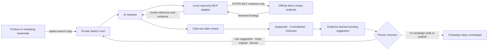

<div align="center">

# Campaign Review Room

### Catch unsupported launch claims before they reach customers.

An evidence-first campaign review workflow where a team and an AI agent work together in a **Switch** room—and a person makes the final call.

<p>
  
  
  
  
</p>

**Project demo:** a rendered video is being prepared. The [storyboard](video/storyboard.md) and [narration script](docs/narration-script.md) are available now.

</div>

> **Demo status:** The workflow has been rehearsed in Switch using an explicitly labeled fictional fixture. The live Official evidence endpoint is currently unavailable (HTTP 503; FalkorDB reports disconnected). Fixture results are not live product evidence.

## Why this exists

Product launch copy can overstate who can use a feature, when it is available, or what results it delivers. Campaign Review Room gives product and marketing teammates a shared place to check each claim against reviewed rollout evidence before they publish.

The demo uses a fictional SaaS campaign. Its draft says CSV export is available to every account, takes seconds to set up, and reduces manual errors by 80%. The fixture supports availability only for US internal testers. It contradicts the broad audience claim and has no evidence for setup time or error reduction, so those claims stay **Unknown**.

## The workflow



1. A person pastes draft copy into the private Switch room.
2. The reviewer separates factual claims and checks each one against the current evidence packet.
3. It shows exact quotes, finding IDs, audience scope, source details, and available timestamps.
4. It may suggest wording only when the evidence supports every factual part.
5. It waits for the person to choose **USE SUGGESTION**, **KEEP ORIGINAL**, or **REVISE**. The reviewer repeats the choice and review reference in the room. It does not edit or publish campaign content.

## What is built

| Capability | What it does |
| --- | --- |
| **Switch room templates** | Provides the event room and private fallback room configuration, with reviewer instructions. |
| **Read-only evidence adapter** | Uses a fixed HTTPS GET to read the fictional Official campaign review. It never sends draft copy to Official. |
| **Claim review packet** | Creates a local SHA-256 reference and returns current evidence for the reviewer to use. |
| **Quote validation** | Checks exact claim quotes against the draft and maps sentences with no quoted claim. This is a review aid; it cannot prove that the AI extracted every claim. |
| **Structured claim cards** | Accepts only quotes found in the copy and finding IDs in the current packet. An unmatched claim remains Unknown. |
| **Promise explanation** | Retrieves the finding and evidence for one named draft. |
| **STE100 sentence-length subset** | Checks whether at least 80% of sentences meet the selected limit: 25 words for descriptive text or 20 for procedural text. |

### Demo result

The fictional review supports this narrower statement:

> Internal testers in the US can use CSV export today.

It is 10 words, so it passes the descriptive 25-word sentence-length check. That check covers **sentence length only**. It does not certify ASD-STE100 compliance or prove the claim; the evidence review and human decision still matter.

## Current verification

| Area | Verified state |
| --- | --- |
| Local adapter | Automated checks cover input bounds, hashing, endpoint scope, evidence fields, quote validation, sentence length, and fail-closed behavior. |
| Switch workflow | Two fixture rehearsals completed. The second separated four claim clauses across two compound sentences and kept unsupported claims Unknown. |
| Human decision | The person posted **USE SUGGESTION** with the review reference in the private fallback room. The reviewer’s required echo and `DECISION_RECORDED` state are not verified; the embedded room view is stuck loading. |
| Live Official evidence | Unavailable on the latest check: `/api/health` returned `503` with `falkorDb: disconnected`; the campaign review also returned `503`. |
| Submission form | The official submission route loads a page shell, but its content remains at “Pulling up this hackathon.” The actual form is not verified. Official rules require a person to submit; an automated agent must not submit an entry. |
| Campaign changes | None. The adapter has no write or publish tool. |
| Demo video | The rendered video is the remaining deliverable the project owner is preparing. The storyboard and narration are in the repository. |

The fixture proves the Switch workflow can run with clearly labeled sample data. It does **not** prove the live Official evidence service works. The adapter fails closed when that service is unavailable.

## Run the adapter

**Requirements:** Node.js 22 or newer and npm.

```sh
cd official-vercel-mcp
npm ci
npm run check
npm start
```

By default, the adapter uses the live Official demo endpoint. To rehearse with the local fictional fixture, set `CAMPAIGN_REVIEW_SOURCE=fictional-demo` before starting it.

**PowerShell**

```powershell
$env:CAMPAIGN_REVIEW_SOURCE = 'fictional-demo'
npm start
```

**macOS / Linux**

```sh
CAMPAIGN_REVIEW_SOURCE=fictional-demo npm start
```

Every fixture-backed response is labeled as fictional demo data. To return to live mode in PowerShell, run `Remove-Item Env:CAMPAIGN_REVIEW_SOURCE -ErrorAction SilentlyContinue` before `npm start`.

The adapter runs over MCP stdio. [official-mcp-session.example.json](official-mcp-session.example.json) shows the local session shape; replace its machine-specific Node and repository paths when configuring your own Switch profile.

## Privacy and human control

- The demo contains fictional Alder & Finch campaign records. Do not use fixture evidence to review real launch copy.
- Draft text is processed by the local adapter to create a hash and validate quotes. The adapter does not send or persist the copy text.
- Evidence packets stay in memory for up to 15 minutes, with a maximum of 10 packets.
- The evidence request is read-only and scoped to one fixed HTTPS endpoint.
- The AI can review and suggest. A person records the decision in the Switch room.
- No tool can update a campaign, approve an Official change, or publish content.
- Claim extraction and semantic claim-to-evidence matching still depend on the reviewer and human oversight; deterministic quote checks cannot prove semantic correctness or extraction completeness.

## Connect it to a real workflow

For a real product launch, replace the fictional endpoint with an authenticated, read-only service that returns approved rollout evidence. Each record should include the feature, eligible audience and region, rollout state, source, owner, and observation/review times. Apply access checks before returning records.

For example, a launch claim says CSV export is available to every account while the approved rollout record says internal testers in the US only. The reviewer can flag the scope mismatch and show the source. Product or marketing then decides what to do in chat. Add a CMS or publishing integration only as a separate, audited workflow with its own explicit human approval gate.

See the [real-world connection and data contract](docs/real-world-connection.md).

## Project guide

- [Switch room setup](campaign-review-private-room.yaml)
- [Reviewer instructions](reviewer-instructions.md)
- [Phased implementation plan and evidence](docs/implementation-plan.md)
- [Submission and demo checklist](docs/event-build-checklist.md)
- [ASD-STE100 scope and limitations](docs/ste100-scope.md)
- [Real-world integration path](docs/real-world-connection.md)
- [Video storyboard](video/storyboard.md)
- [Video narration](docs/narration-script.md)

## Built with

[Switch](https://www.wemakedevs.org/hackathons/switch) · Node.js · MCP · fictional campaign evidence

