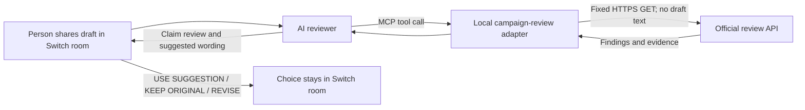

# How the two repositories connect

This hackathon submission is one workflow implemented across two public repositories. They remain separate projects and connect through a narrow HTTP API.

| Repository | Role in the workflow |
| --- | --- |
| [switch-campaign-review](https://github.com/maitreyaaaaa/switch-campaign-review) | The submitted Switch room setup, reviewer instructions, and local read-only MCP adapter. |
| [official](https://github.com/maitreyaaaaa/official) | The companion launch-claim product and the source of campaign review findings and evidence. |

## Runtime path



The adapter calls only:

```text
GET https://official-sand.vercel.app/api/campaigns/campaign-csv-launch/review
```

It creates a local reference for the copy, requests the current evidence packet, and gives the result to the reviewer. The draft copy is not sent to Official. The adapter validates exact claim quotes and that selected finding IDs belong to the current packet. Those checks help catch mistakes; they do not prove that an AI extracted every claim or matched evidence semantically.

The reviewer does **not** crawl either GitHub repository at runtime. It uses the Official API response. Reviewers can inspect both source repositories separately to understand how the provider and Switch-side adapter are implemented.

## Reviewer entry points

- Start with this repo's [README](../README.md) and [Switch reviewer instructions](../reviewer-instructions.md).
- Inspect the integration boundary in [`official-vercel-mcp/src/review.mjs`](../official-vercel-mcp/src/review.mjs) and tool registration in [`official-vercel-mcp/src/server.mjs`](../official-vercel-mcp/src/server.mjs).
- Review endpoint-scope, quote, and failure behavior in [`official-vercel-mcp/test/review.test.mjs`](../official-vercel-mcp/test/review.test.mjs).
- Inspect the companion [Official repository](https://github.com/maitreyaaaaa/official) for the provider application and API implementation.
- Run the local adapter checks from `official-vercel-mcp` with `npm ci` followed by `npm run check`.

## Evidence status

- Both repositories are public and linked above.
- The Switch-side adapter is wired to the Official review route and can run against its labeled fictional fixture.
- The latest live check on **November 8, 2026** returned HTTP 200 from `/api/health` with `falkorDb: connected` and HTTP 200 from the review route with four synthetic fixture findings (two contradicted claims, one supported claim, and one unchecked draft). This verifies the deployed API path and response shape. The records are fictional demo data, not evidence about a real company or launch.
- The final human choice remains in the Switch room. The mock completion record is labeled `DECISION_RECORDED (MOCK)`; it is not a real persistent Official decision or a campaign update.

## Judging context

The [hackathon page](https://www.wemakedevs.org/hackathons/switch) lists four criteria: use of Switch, technical execution and reproducibility, creativity and impact, and presentation. It describes organizer review and finalist judges; it does not document an AI-based scoring process. This map makes the actual code and boundaries easy to inspect without implying a score or promising a result.
